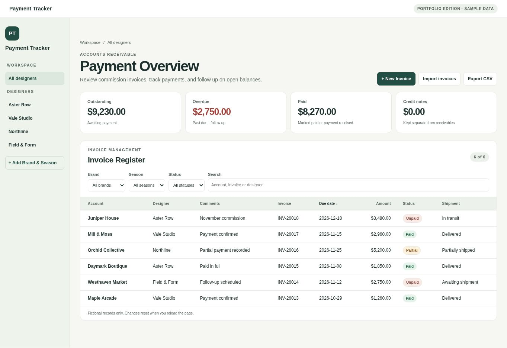

# Invoice Tracker

The code is based on tools I developed for real showroom workflows. The records and figures shown are fictional to protect client confidentiality.

This repository contains an interactive portfolio recreation, not the original production application. The interface reflects the original workflow, but all sample records and amounts are fictional. Production data, credentials, client identities, and private links are not included.

**Problem:** The team needed one place to see invoices, payment status, overdue balances, and shipments without reconciling several views by hand.

**What I built:** A Google Sheets-backed web app using Apps Script, HTML, CSS, and JavaScript. It tracks unpaid, partial, and paid invoices alongside due dates and shipment status. The original app included a PDF invoice review workflow; this portfolio edition replaces it with a built-in example and never uploads a file.

[Open the invoice tracker](index.html). Filter by designer or payment status, then select an unpaid invoice to record a sample payment. The dashboard totals update immediately. You can also add or import a fictional invoice and export sample rows as CSV.

## Run locally

Open `index.html` in a modern browser. No installation, sign-in, network connection, or backend is required. Changes reset when you reload. Use fictional information only.
